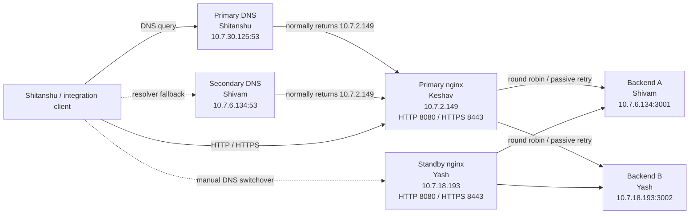

# Private Network Service Platform — Phase 1 + Phase 2

A four-Mac private-LAN service demonstrating private DNS, reverse proxying, HTTPS termination, response caching, backend load balancing and failover, a secondary resolver, a standby edge, scoped firewall design, and layered troubleshooting.

> **Evaluation status — 24 November 2026:** core DNS and edge health have genuine committed evidence. Additional behaviors were reported during team testing but still need dedicated committed evidence. macOS PF isolation, the full troubleshooting challenge, and Wireshark captures are not claimed as passed. LAN addresses below are a verified lab-session snapshot, not permanent configuration; reusable files use `config/inventory.env` and templates.

## Objectives

- Resolve `app.team1.test` and `api.team1.test` through private primary and secondary DNS resolvers.
- Terminate TLS at nginx and forward requests to two Node.js backends.
- demonstrate round-robin distribution and passive backend failover using an uncached health endpoint;
- demonstrate nginx `MISS`/`HIT` caching on HTTPS `/api/status`;
- support a controlled, manual DNS switchover to a standby nginx edge;
- design backend isolation with scoped macOS PF anchors and safe rollback;
- diagnose failures in the order DNS → TCP → TLS → HTTP/application.

## Architecture



The standby edge is not selected automatically. During a controlled edge migration, both DNS record files are manually changed from the primary edge IP to the standby edge IP. The configured TTL is 30 seconds, but client and resolver cache behavior still affects convergence.

## Team and verified lab inventory

| Member | Verified 24 Nov 2026 IP | Responsibilities |
| --- | --- | --- |
| Shitanshu | `10.7.30.125` | Primary DNS, integration client, verification |
| Keshav | `10.7.2.149` | Primary nginx, TLS, reverse proxy, load balancing, caching |
| Shivam | `10.7.6.134` | Backend A on `3001`, secondary DNS |
| Yash | `10.7.18.193` | Backend B on `3002`, standby nginx |

Reconfirm every address at the start of a new lab session. Never copy these values into reusable templates.

## Technologies

Node.js built-in HTTP server, nginx, dnsmasq, locally issued TLS certificates, macOS PF, POSIX shell, curl, dig, OpenSSL, netcat, Git/GitHub, and Wireshark where captures are explicitly collected.

## Repository structure

```text
backend-a/, backend-b/    Node.js backends
config/                   ignored local inventory template
dns/                      primary/secondary resolver and record templates
nginx/                    primary/standby edge templates and shared proxy policy
firewall/                 scoped PF templates, validation, apply and rollback
scripts/backend/          backend launcher
scripts/verify/           DNS/TCP/TLS/HTTP/failover checks
scripts/tests/            local backend and renderer tests
docs/                     architecture, deployment, demo, report and viva guides
evidence/                 evidence register and sanitized committed results
generated/                rendered machine-specific files; ignored by Git
```

## Prerequisites

- Four authorized Macs on the same private LAN.
- Git and Homebrew.
- Node.js on both backend Macs.
- nginx on both edge Macs.
- dnsmasq on both DNS Macs.
- `curl`, `dig`, `openssl`, `nc`, and `rg` for validation.
- A locally issued certificate covering `app.team1.test` and `api.team1.test`.
- The public CA trusted on the demonstration client.
- TLS private keys stored outside this repository.

## Clone and prepare

On each Mac:

```bash
git clone --branch codex/phase-2 --single-branch \
  https://github.com/Silence91169/CN_Private-Service_Project.git
cd CN_Private-Service_Project
git status --short --branch
```

Create a local, ignored inventory:

```bash
cp config/inventory.example.env config/inventory.env
nano config/inventory.env
scripts/render-configs.sh
```

For the verified lab snapshot, use the four current IPs from the table, ports `3001`, `3002`, `8080`, and `8443`, TTL `30`, the real active backend interfaces, the output of `brew --prefix`, and edge-local certificate/key paths. Review everything under `generated/`; never commit it.

Run non-destructive repository checks:

```bash
bash scripts/run-static-tests.sh
```

## One-command live demonstration

Start the interactive, non-destructive viva launcher from the repository root:

```bash
bash scripts/demo.sh
```

The menu verifies both DNS servers, samples uncached `/healthz` for backend selection, verifies trusted TLS/HTTPS, demonstrates the `/api/status` cache, checks the standby edge, checks all four machines, runs local/static tests, or performs the complete safe sequence.

For a single non-interactive section:

```bash
bash scripts/demo.sh --run 1       # both DNS servers
bash scripts/demo.sh --run 8       # complete non-destructive demo
bash scripts/demo.sh --run 9       # GitHub/project information
```

To capture genuine output for later review:

```bash
bash scripts/demo.sh --capture
```

This creates an ignored `evidence/live-demo/session-TIMESTAMP/demo.log`. It does not commit evidence. Review the file for sensitive or unrelated information before explicitly adding it.

The launcher reads `config/inventory.env` when present. Explicit `DEMO_*` variables can override individual values. Without a complete inventory it refuses to start network tests and reports the missing values; it never silently uses an old address. If college Wi-Fi assigns new addresses, update the ignored inventory and rerun:

```bash
ipconfig getifaddr en0
ipconfig getifaddr en1
nano config/inventory.env
scripts/render-configs.sh
bash scripts/demo.sh --run 6
```

Do not edit reusable templates merely because DHCP changed a session IP.

Each teammate can run a read-only role check:

```bash
bash scripts/demo-preflight.sh shitanshu
bash scripts/demo-preflight.sh keshav
bash scripts/demo-preflight.sh shivam
bash scripts/demo-preflight.sh yash
```

If the live LAN fails during evaluation, show the preserved [final health transcript](evidence/final-verification/live-health-check.txt), explain its scope honestly, and use the README architecture plus Git history. Do not convert old evidence into a claim that the current network passed.

## Start and check each role

### Shivam — Backend A and secondary DNS

```bash
scripts/backend/run.sh A
curl -i http://127.0.0.1:3001/healthz
dns/scripts/validate.sh "$PWD/generated/dns/secondary/dnsmasq.conf"
```

Expected backend headers include `X-Backend: A` and `Cache-Control: no-store`.

### Yash — Backend B and standby nginx

```bash
scripts/backend/run.sh B
curl -i http://127.0.0.1:3002/healthz
nginx/scripts/validate.sh "$PWD/generated/nginx/standby.conf"
```

Expected backend headers include `X-Backend: B` and `Cache-Control: no-store`.

### Keshav — Primary nginx

```bash
nginx/scripts/validate.sh "$PWD/generated/nginx/primary.conf"
nginx/scripts/deploy.sh "$PWD/generated/nginx/primary.conf" primary
```

`deploy.sh` is a dry run unless `--apply` is explicitly supplied. It installs configuration but does not start or reload nginx.

### Shitanshu — Primary DNS and verification

```bash
dns/scripts/validate.sh "$PWD/generated/dns/primary/dnsmasq.conf"
scripts/verify/check-dns.sh 10.7.30.125 10.7.2.149
scripts/verify/check-dns.sh 10.7.6.134 10.7.2.149
```

The literal IPs above reproduce the verified 24 November lab snapshot. Use the current `config/inventory.env` values in later sessions.

Full installation, supervised state-changing commands, and rollback are in [docs/deployment.md](docs/deployment.md).

## Service verification

### HTTP and HTTPS

```bash
curl -i http://app.team1.test:8080/healthz
curl -i https://app.team1.test:8443/healthz
curl -i https://api.team1.test:8443/api/status
```

Do not use `curl -k` as trusted-TLS evidence. For an edge-specific check without changing DNS:

```bash
scripts/verify/check-http.sh EDGE_IP 8443
scripts/verify/check-tls.sh EDGE_IP 8443
```

### Round-robin and backend failover

`/healthz` is uncached and identifies the selected backend:

```bash
scripts/verify/check-failover.sh 10.7.2.149 8443 10
```

With both backends healthy, samples should contain A and B; strict alternation is not guaranteed. nginx uses passive failure detection (`max_fails=1`, `fail_timeout=10s`) and retries eligible failures. Backend failure/recovery was reported during team testing, but a dedicated committed transcript is still required.

### DNS redundancy

```bash
scripts/verify/check-dns.sh 10.7.30.125 10.7.2.149
scripts/verify/check-dns.sh 10.7.6.134 10.7.2.149
```

The committed final health transcript proves that both resolvers returned `10.7.2.149`. Resolver-outage behavior and manual switchover were reported live; add a dedicated transcript before treating them as committed evidence.

### nginx cache

Caching applies only to the exact HTTPS `/api/status` location:

```bash
curl -sS -D - -o /dev/null https://app.team1.test:8443/api/status
curl -sS -D - -o /dev/null https://app.team1.test:8443/api/status
```

The first request after an empty/expired entry should show `X-Cache-Status: MISS`; an immediate repeat should show `HIT`. Caching was reported during team testing, but the repository still needs a dedicated timestamped MISS/HIT transcript.

### Standby edge and manual migration

Validate the standby directly without changing DNS:

```bash
scripts/verify/check-http.sh 10.7.18.193 8443
```

The committed evidence includes standby HTTP `200` with `X-Backend: B`. A migration uses `dns/records/standby-edge.hosts.template` on both DNS servers, waits for TTL/cache convergence, verifies the service, and restores the primary record. This is controlled manual switchover—not automatic failover.

## Troubleshooting and rollback

Diagnose in dependency order:

```bash
scripts/verify/check-dns.sh RESOLVER_IP EXPECTED_EDGE_IP
scripts/verify/check-tcp.sh EDGE_IP 8443
scripts/verify/check-tls.sh EDGE_IP 8443
scripts/verify/check-http.sh EDGE_IP 8443
```

Or run the ordered wrapper after restoring the primary edge:

```bash
scripts/verify/diagnose.sh config/inventory.env
```

Rollback principles:

- restore primary-edge host records on both resolvers;
- wait one TTL or flush only the designated client cache with explicit approval;
- flush only the `team1/backend` PF anchor with `firewall/rollback.sh --apply`;
- restore the client’s original DNS settings;
- validate before any service reload.

See [docs/troubleshooting.md](docs/troubleshooting.md) and [docs/deployment.md](docs/deployment.md).

## Verification status

| Feature | Status | Basis |
| --- | --- | --- |
| Primary DNS answer | Verified with committed evidence | Both names resolved to primary edge in `live-health-check.txt` |
| Secondary DNS answer | Verified with committed evidence | Secondary returned primary edge IP |
| Primary HTTP | Verified with committed evidence | HTTP `200`, `X-Backend: A` |
| Standby HTTP | Verified with committed evidence | HTTP `200`, `X-Backend: B` |
| Primary HTTPS | Verified with committed evidence | `HTTPS 200`; detailed certificate transcript still desirable |
| Reverse proxy | Verified with committed evidence | Edge responses include backend identity |
| Round-robin A/B | Reported live; evidence incomplete | Team observation, no dedicated committed transcript |
| Backend failure/recovery | Reported live; evidence incomplete | Dedicated before/failure/recovery transcript required |
| DNS redundancy/outage test | Reported live; partial committed evidence | Both resolvers proven; outage transcript missing |
| Manual DNS edge switchover | Reported live; evidence incomplete | Standby accessibility proven; cutover transcript missing |
| nginx caching | Reported live; evidence incomplete | Dedicated MISS/HIT transcript missing |
| PF backend isolation | Implemented, not fully validated | Templates/scripts exist; no committed live proof |
| Layered fault challenge | Implemented, not fully validated | Diagnostic scripts exist; scenarios not evidenced |
| Wireshark DNS/TCP/TLS captures | Not verified in repository | No reviewed captures committed |
| Static/local automation | Verified | `scripts/run-static-tests.sh` passes locally |

Committed evidence: [evidence/final-verification/live-health-check.txt](evidence/final-verification/live-health-check.txt). The complete evidence policy and gaps are tracked in [evidence/README.md](evidence/README.md).

## Security considerations

- Never commit CA keys, TLS private keys, passwords, tokens, `.env` files, `config/inventory.env`, or `generated/`.
- Treat screenshots, logs, and packet captures as potentially sensitive.
- PF scripts default to dry-run, use a dedicated anchor, and do not enable PF globally.
- DNS-cache and nginx/PF mutations require explicit `--apply` or manual commands.
- This repository does not automatically change macOS DNS, certificate trust, interfaces, firewall state, or running services.
- Review `git status`, staged diffs, and secret scans before every push.

## Known limitation

- IP addresses may change between lab sessions.
- Edge migration is manual DNS switchover and is subject to TTL/cache convergence.
- nginx upstream checks are passive rather than active health probes.
- The active primary nginx remains a single point of service entry until DNS is changed.
- A second DNS server does not automatically fail over the edge.
- The committed evidence set is smaller than the set of tests reported by the team.

## Evaluation guides

- [Architecture](docs/architecture.md)
- [Deployment and rollback](docs/deployment.md)
- [Five-minute viva demonstration](docs/demo-script.md)
- [Technical report](docs/technical-report.md)
- [Troubleshooting runbook](docs/troubleshooting.md)
- [Viva questions](docs/viva-questions.md)
- [Screenshot checklist](docs/screenshot-checklist.md)
